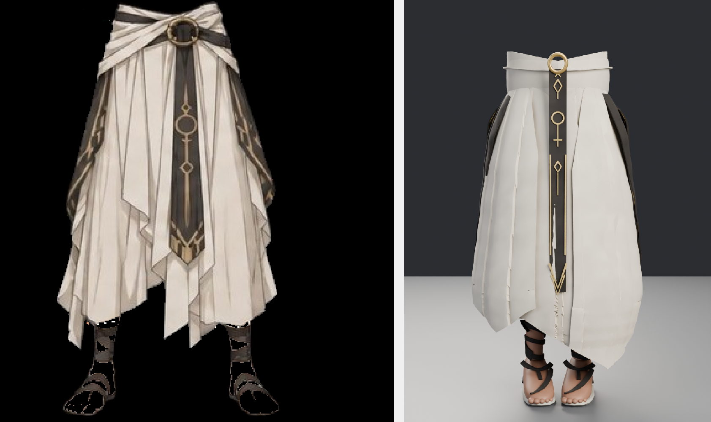

# DRESS1 — Gonna cerimoniale avorio e ottone (game-ready)

Capo ricostruito da zero partendo dal concept dell'utente e dal modello grezzo
Tripo `ImageToStl.com_ornate+robe+3d+model.blend`.



## Cosa e' cambiato rispetto al sorgente

Il file di partenza era un **fermo immagine** del concept, non un capo
indossabile:

| | sorgente (Tripo) | **DRESS1** |
|---|---|---|
| triangoli | 461.734 non ottimizzati | **78.000** (LOD0), stoffa e ricami decimati separatamente |
| struttura | un'unica mesh fusa, senza logica | 6 materiali, 20+ pezzi logici (gonna, falde, scialli, fascia, staffa, caviglie, sandali) |
| schiena | blocco piatto e squadrato | gonna continua con pieghe e due falde sovrapposte |
| piedi | due salsicciotti senza dita | piedi con cinque dita, sandalo aperto, suola con bordo, fascette a Y |
| geometria volante | 3 isole staccate a mezz'aria ai lati | nessuna: tutto e' agganciato al corpo |
| pieghe | dipinte nella texture, la superficie era liscia | **pieghe geometriche a coltello** (26 pieghe sulla gonna, 13-15 sulle falde) |
| dettagli dorati | solo colore nella basecolor | **geometria** in oro: anello, catena di simboli sulla staffa, rune sugli scialli |
| materiale | basecolor + RM + normal, nessuna occlusione | 6 materiali PBR con AO bakeata, normal, ORM |
| scala | 1,0 unita' * 0,81 di altezza, arbitraria | **1,089 m** metrici, origine ai piedi |

## Il capo

E' composto da strati concentrici, tutti generati dalla **stessa superficie**
`surface(angolo, quota, strato)`: e' la regola che tiene insieme il modello —
nessun pezzo compenetra un altro e nessun ricamo "galleggia".

```
z = 1,086  bordo alto della fascia ai fianchi
z = 1,040  cintura scura + anello d'ottone
z = 0,945  fondo della fascia
z = 0,964  attacco della gonna
z = 0,292  orlo medio (punte a 0,218)
z = 0,000  pavimento
```

| pezzo | descrizione |
|---|---|
| gonna | griglia 240×64, pieghe a dente di sega (`knife`), orlo irregolare a tre lobi |
| sottogonna | chiude il volume, offset −45 mm, pieghe smorzate sull'orlo: non buca mai la gonna |
| falde (5) | `Lap_FrontL/FrontR/SideL/SideR/Back`: petali sovrapposti con punta e orli rialzati |
| scialli (4) | nastri scuri che scendono dai fianchi assottigliandosi, piegati come la gonna |
| fascia | corpo avorio con bordo alto ondulato + due teli incrociati a X |
| anello | toro d'ottone da 6 cm, appoggiato sulla cintura |
| staffa | nastro scuro rastremato con punta a freccia, 15 cm di ricami dorati |
| caviglie | tre bande sottili a V + nastro diagonale, pelle scoperta fra le bande |
| sandali | suola avorio con bordo, fascette a Y, laccio al tallone |

### Piega a coltello

Le pieghe non sono sinusoidi (si leggerebbero come onde morbide): sono un
**dente di sega asimmetrico** — salita dolce, caduta ripida — sommato a basse
frequenze diverse e modulato per gruppi:

```python
def knife(x):                     # dente di sega periodico
    t = (x / TAU) % 1.0
    return 2.0 * (t ** 0.62) - 1.0

base = 0.66*knife(a*13) + 0.22*knife(a*6.5) + 0.12*tri(a*26)
base = sharpen(base, 1.02)        # tanh: rende lo spigolo netto senza gradini
amp  = 0.020 * smoothstep(0, 0.12, v)     # in vita la stoffa e' tesa
amp *= 1 - 0.85 * smoothstep(0.90, 1, v)  # l'orlo si distende: niente dentini
```

### Strati e compenetrazioni

Ogni lembo ha uno **strato suo** (`lapB` 26 mm, `lap` 34, `lap2` 46, `lap3` 52,
`drape` 56, `drape2` 62, `trim` 68, `strap` 74 mm). Due pezzi sullo stesso
strato si compenetrano: dove le superfici coincidono il render alterna i due
materiali e il bordo sembra seghettato. Per questo, per esempio, la falda
frontale destra sta sotto la sinistra, e i secondi scialli sopra i primi.

Le falde non seguono il profilo nudo della gonna ma la sua superficie
**pieghettata** (`skirt_disp`): cosi' le creste delle pieghe non trapassano la
stoffa sovrapposta, e il lembo si appoggia come farebbe il tessuto vero.

## Materiali

| materiale | baseColor | metallic | roughness | map | note |
|---|---|---|---|---|---|
| `DRESS1_Linen` | avorio caldo | 0 | mappa | base, normal, ORM, AO | lino del capo, double-sided |
| `DRESS1_Wool` | lana scura | 0 | mappa | base, normal, ORM, AO | staffa, scialli, fasciature |
| `DRESS1_GoldTrim` | oro | 0,55 | 0,46 | — | ricami: opachi per restare leggibili a 3 mm |
| `DRESS1_Gold` | ottone | 0,82 | 0,40 | — | anello, a tinta piena (una texture da 6 cm si legge come camouflage) |
| `DRESS1_Canvas` | tela | 0 | mappa | base, normal, ORM, AO | suola |
| `DRESS1_Skin` | pelle | 0 | mappa | base, normal, ORM, AO | piedi e caviglie |

Le mappe sono **generate proceduralmente** (numpy + value noise, trama tessuta a
1 texel, fibrille, macchie di usura) e l'occlusione e' **bakeata su Cycles**
(2048², 64 spp, distanza 0,30 m). Tutto viene scritto su PNG, ricaricato e
impacchettato: senza quel giro un'immagine "generated" si ricarica nera al
salvataggio.

L'AO e' collegata anche al nodo `glTF Material Output`, che e' quello che
l'exporter legge per scrivere `occlusionTexture` nel `.glb`.

## Export

| file | contenuto |
|---|---|
| `DRESS1.blend` | scena completa, 6 materiali, 13 texture packate (11.7 MB) |
| `DRESS1.glb` | glTF 2.0 binario, LOD0, 78.000 tri, nessuna estensione (11.7 MB) |
| `DRESS1_LOD1.glb` | 27.298 tri (35%), mappe a metà risoluzione (3.8 MB) |
| `DRESS1_LOD2.glb` | 9.351 tri (12%), mappe a un quarto (1.2 MB) |
| `DRESS1.fbx` | FBX binary, unita' metriche, texture incorporate (13.5 MB) |
| `DRESS1_tex/` | le mappe sciolte |
| `QA.md` | report generato da `tools/06_validate.py` |

Nessuna skin, nessuna animazione: e' un **asset di abbigliamento**, pensato per
essere vestito da un personaggio o usato come prop.

Quote verificate sui `.glb`: **108,9 cm** di altezza, 53,5 cm di larghezza,
47,7 cm di profondita', origine fra i piedi (scarto 3 mm), centrato sull'asse X
(0,3 mm). Nessuna estensione glTF oltre al core: si apre in Unity, Unreal,
Godot e nei viewer web senza plugin.

## Pipeline

```
tools/01_build.py       genera la geometria (408k tri grezzi)
tools/02_optimize.py    split stoffa/dettagli, decimation separata, UV, normals
tools/03_material.py    mappe procedurali, AO bake, 6 materiali PBR
tools/04_export.py      .blend, .glb x3, .fbx, texture sciolte
tools/05_preview.py     render di presentazione
tools/06_validate.py    QA dei .glb (parser glTF senza Blender)
```

```bash
export DRESS1_WORK=/tmp/dress1_work
for f in tools/01_build.py tools/02_optimize.py tools/03_material.py \
         tools/04_export.py tools/06_validate.py; do python "$f"; done
```

Tutto gira **dentro Blender** (modulo `bpy`, 4.5 LTS): nessuna dipendenza
esterna oltre a numpy e Pillow, che arrivano con il pacchetto `bpy`.

## Anteprime

| file | cosa mostra |
|---|---|
| `preview/hero_front.png` | vista frontale, luce da studio |
| `preview/hero_three.png` | tre quarti |
| `preview/hero_waist.png` | primo piano: fascia, anello, simboli dorati |
| `preview/hero_feet.png` | primo piano: caviglie fasciate e sandali |
| `preview/hero_back.png` | retro |
| `preview/turnaround.png` | quattro viste affiancate |
| `preview/ref_compare.png` | concept dell'utente contro il render |

## Note per il motore

- 1 unita' = 1 metro, altezza 1,089 m, origine fra i piedi (z = 0)
- Y-up negli export
- materiali glTF-safe: nessuna estensione esotica
- `DRESS1_Linen`, `DRESS1_Wool`, `DRESS1_Canvas` e `DRESS1_Skin` sono
  double-sided (gonna e falde sono fogli aperti)
- i LOD usano gli stessi materiali: si swappano a runtime senza rimappare
- per un rig: la gonna ha bisogno di 4-8 ossa di stoffa e la staffa di 2,
  altrimenti si muove come un tubo di lamiera
