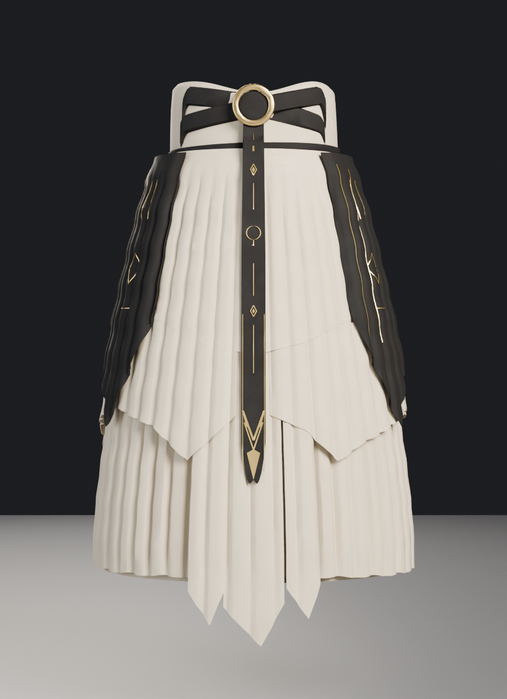

# DRESS1 — capo cerimoniale maschile

Capo statico dalla vita all'orlo, ricostruito sulla reference dell'utente. Contiene **solo il vestito**: nessun corpetto, corpo, gambe o calzature. La vita e l'orlo sono aperti per permettere l'adattamento a un personaggio maschile.

## Dettagli

- **Fascia avorio piatta** (non un rotolo) con il bordo alto che scende al centro, dove il nodo stringe la stoffa.
- **X in vita di lana scura**: due cinghie larghe che salgono dai fianchi e si incrociano davanti alla fibbia, come nel disegno.
- **Anello d'ottone** piccolo e schiacciato (0,070 m di diametro) appoggiato sul nodo; il foro è riempito da un fascio di lana scura, così la fibbia legge vuota e in ombra.
- **Staffa frontale scura** con il motivo dorato completo: asta affusolata, rombo con centro pieno, cerchio attraversato dalla croce, secondo rombo, due V annidate e cuneo dorato alla punta; filetti lungo i bordi.
- **Gonna di lino ad A** con **46 pieghe fitte e nette** (cresta piatta in luce, valle a spigolo in ombra), orlo appena ondulato sopra la caviglia.
- **Tre teli sovrapposti** con orli a punta: due grandi che si incrociano al centro e uno corto in cima, che dà il taglio diagonale alla vita.
- **Tre lingue** di lino al centro del davanti, le punte più basse del capo.
- **Due pannelli di lana** sui fianchi, larghi, lisci, con filetto dorato sul bordo e piccoli segni geometrici che scendono verso la punta.
- Fodera interna di lino che chiude il guscio sotto la vita senza stringere il passaggio per le gambe.

## File

| File | Contenuto |
|---|---|
| `DRESS1.blend` | Scena Blender con mesh e texture incorporate |
| `DRESS1.glb` | glTF 2.0 autonomo, 78.498 triangoli |
| `DRESS1_LOD1.glb` | 29.848 triangoli |
| `DRESS1_LOD2.glb` | 10.608 triangoli |
| `DRESS1.fbx` | FBX con materiali e texture incorporate |
| `DRESS1_tex/` | Mappe PNG separate, inclusa AO |
| `preview/` | Render, turnaround e confronto con la reference |
| [`QA.md`](QA.md) | Controlli e misure degli export |

Il modello è una mesh statica senza rig, skin o animazioni: per usarlo su un personaggio occorrono adattamento, pesatura allo scheletro e gestione delle collisioni o del movimento della stoffa. Il capo è alto circa 91,5 cm e largo 54,6 cm all'orlo; l'origine è a terra, con l'orlo più basso a circa 14 cm. Blender e FBX sono Z-up (fronte −Y); i GLB sono Y-up. I materiali PBR usano texture a 1024² e AO bakeata; i LOD hanno texture ridimensionate.

Pipeline riproducibile e test: [`tools/README.md`](tools/README.md).
