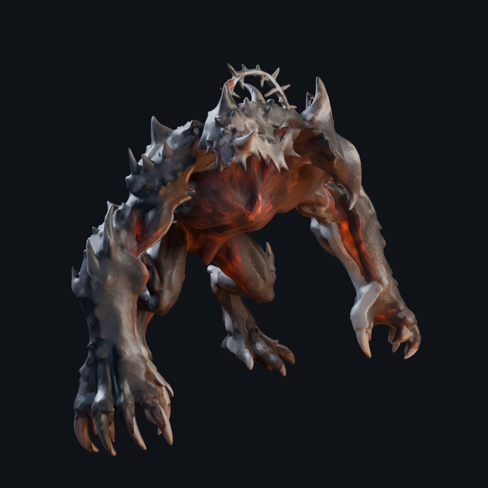
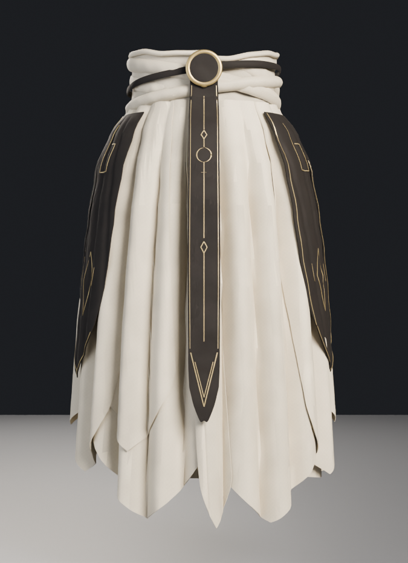
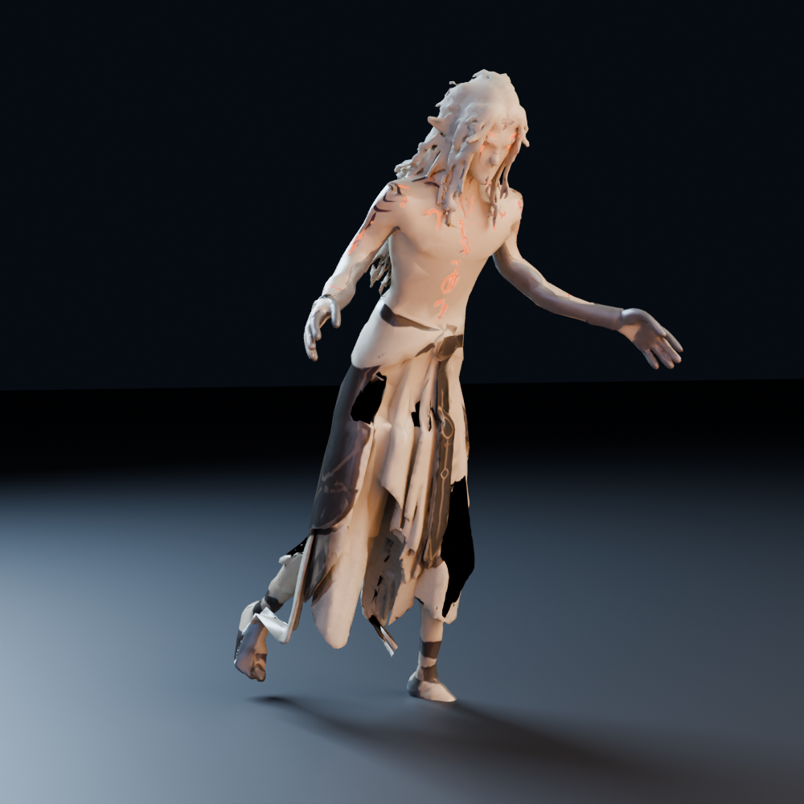

# GAME_CHARACTERS

Modelli di personaggi per videogiochi, lavorati per essere pronti al motore.

| personaggio | stato | file |
|---|---|---|
| **BOSS1** — Demone Cornuto | game-ready: 80k tri, rig 34 ossa, 5 animazioni, PBR 2K + AO, LOD1/LOD2, scala 2,90 m | [BOSS1/](BOSS1/) → `BOSS1.blend`, `BOSS1.glb`, `BOSS1.fbx`, `BOSS1_LOD1.glb`, `BOSS1_LOD2.glb` |
| **ELFO1** — Elfo Runico | game-ready: 55k tri, rig 43 ossa, 5 animazioni, PBR 2K + AO + rune emissive, LOD1/LOD2, scala 1,85 m | [ELFO1/](ELFO1/) → `ELFO1.blend`, `ELFO1.glb`, `ELFO1.fbx`, `ELFO1_LOD1.glb`, `ELFO1_LOD2.glb` |
| **DRESS1** — Vestito cerimoniale | game-ready: 77k tri, 4 materiali PBR con AO bakeata, LOD1/LOD2, scala 0,96 m — **solo il vestito**, senza corpo, gambe né piedi | [DRESS1/](DRESS1/) → `DRESS1.blend`, `DRESS1.glb`, `DRESS1.fbx`, `DRESS1_LOD1.glb`, `DRESS1_LOD2.glb` |

## BOSS1 in breve

- 501.022 → **80.000** triangoli, densita' adattiva (piu' dettaglio su testa,
  aureola e artigli) e simmetria X; UV originali intatte
- scheletro 34 ossa con **skinning geodesico**, max 4 influenze, pesi normalizzati
- 5 clip a 30 fps: `BOSS1_Idle`, `BOSS1_Walk` (loop, in place), `BOSS1_Roar`,
  `BOSS1_Attack`, `BOSS1_Death`
- materiale PBR glTF-safe: basecolor e normal 2K, ORM con **AO bakeata**,
  vene emissive
- scala metrica reale (**2,90 m**), export Y-up, LOD1 (32k) e LOD2 (9,6k)
- QA automatica dei file esportati in [`BOSS1/QA.md`](BOSS1/QA.md)
- pipeline riproducibile in `BOSS1/tools/`

Confronto della densita' di triangoli tra la v1 (60k uniformi) e questa
versione (80k adattivi): `BOSS1/preview/detail_compare.png`.

## DRESS1 in breve

- Capo cerimoniale maschile **dalla vita all'orlo**, senza corpo o calzature; vita e fondo aperti per l'adattamento al personaggio.
- Lino avorio con pieghe morbide, falde sovrapposte e orlo asimmetrico; fascia annodata e fibbia in ottone.
- Nastro frontale e pannelli laterali scuri con dettagli dorati ispirati alla reference.
- Asset statico: 4 materiali PBR, 77.224 triangoli, LOD1 e LOD2. Per animarlo serve il rigging.
- QA e pipeline in [`DRESS1/`](DRESS1/).

## ELFO1 in breve

- 339.022 → **55.000** triangoli, densita' adattiva su viso, orecchie a punta,
  ciocche e falde del gonnellone, simmetria X; UV originali intatte
- scheletro **43 ossa** (corpo + due catene di ciocche, cresta e otto ossa di
  gonnellone) con skinning geodesico e maschere anatomiche, max 4 influenze
- 5 clip a 30 fps riscritte con angoli anatomici e **verifica numerica**
  automatica: `ELFO1_Idle`, `ELFO1_Walk` (loop, contatto dei piedi su ogni
  frame), `ELFO1_Run` (loop, con fase di volo), `ELFO1_Cast` (spinta in
  avanti), `ELFO1_Death` (caduta appoggiata al pavimento)
- materiale PBR glTF-safe double-sided: basecolor e normal 2K, ORM con **AO
  bakeata**, **rune emissive** ricavate dai simboli dipinti, **occhi e
  sopracciglia dipinti** sulla basecolor (il sorgente aveva il viso liscio)
- scala metrica reale (**1,85 m**), export Y-up, LOD1 (19,2k) e LOD2 (6,6k)
- QA automatica dei file esportati in [`ELFO1/QA.md`](ELFO1/QA.md)
- pipeline riproducibile in `ELFO1/tools/`

Confronto tra il sorgente da 339k triangoli e il LOD0 da 55k sullo stesso primo
piano: `ELFO1/preview/detail_compare.png`.
